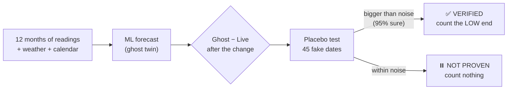
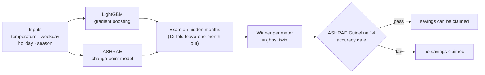
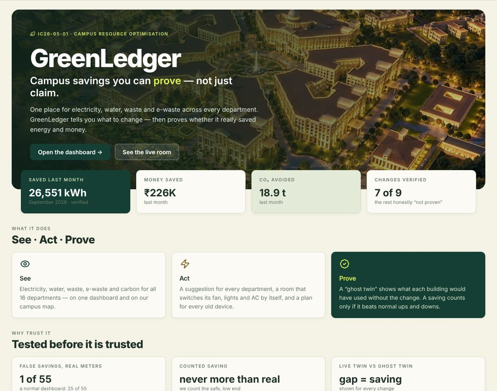
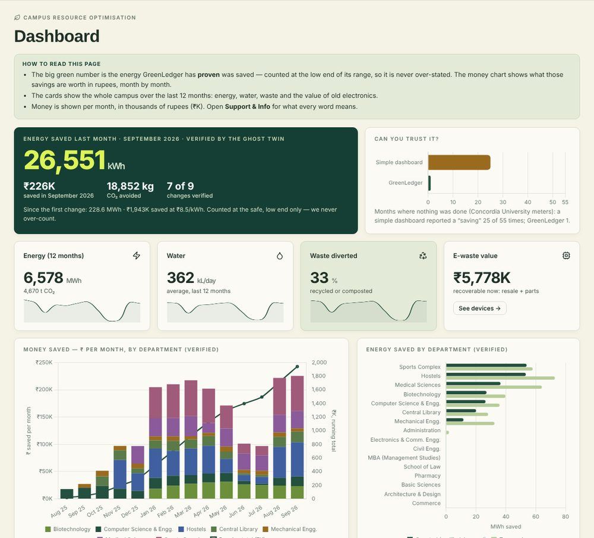
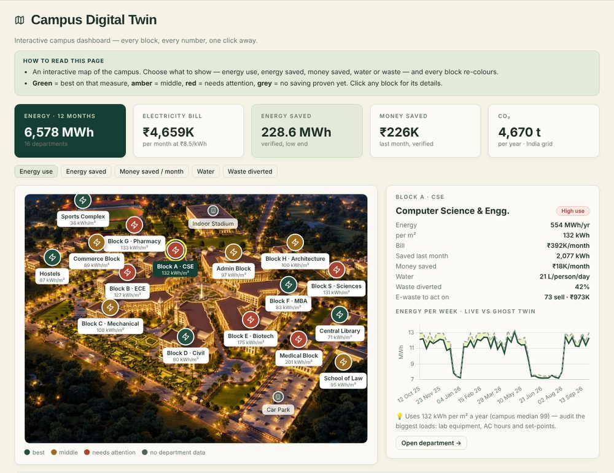
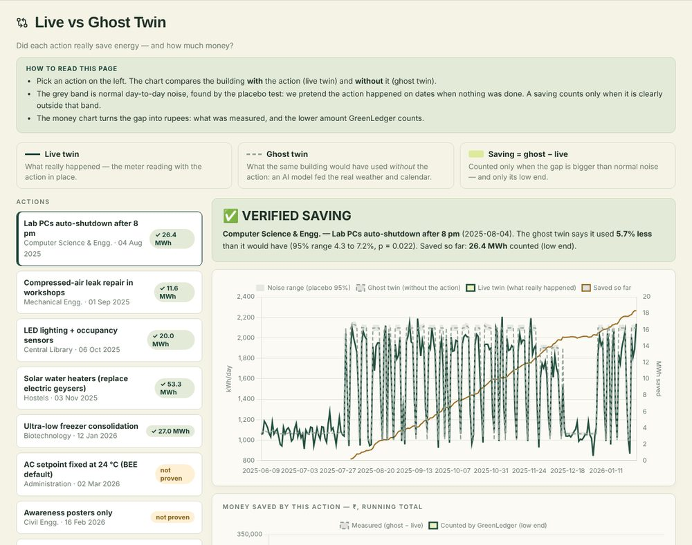
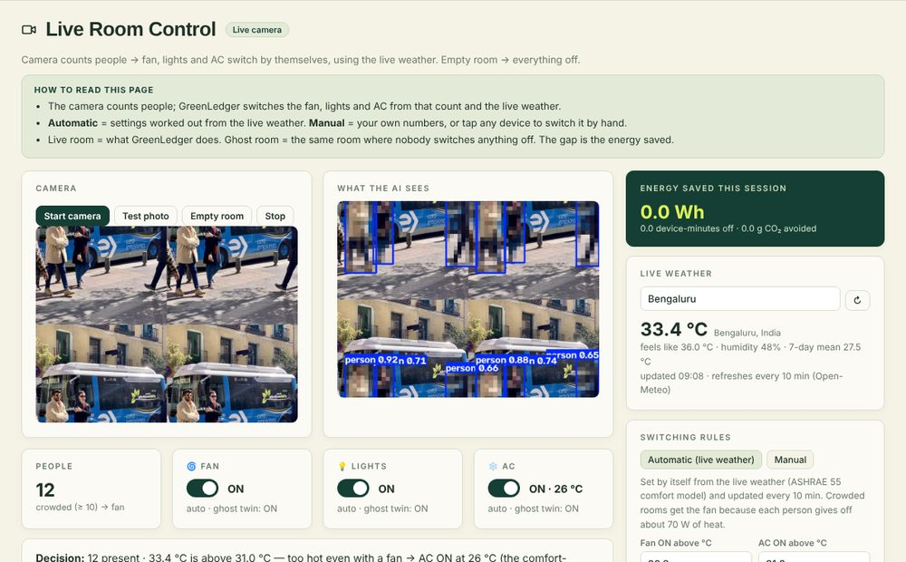
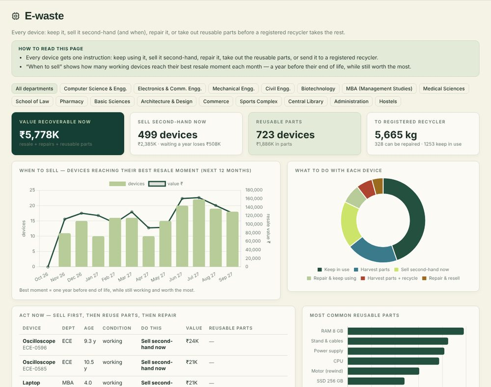

 

  

**[Live demo](https://performances-cal-portal-exploring.trycloudflare.com/)** ·
**[The problem](#-the-problem)** ·
**[How it works](#-how-it-works--the-ghost-twin)** ·
**[Architecture](#%EF%B8%8F-system-architecture)** ·
**[Results](#-results)** ·
**[Run it](#-run-it-yourself)** ·
**[Team](#-team-shinzen)**

---

> [!TIP]
> **In one sentence:** GreenLedger shows every resource a campus uses, tells you what to change — and then **proves** whether the change really saved energy and money, counting only what it can prove.

| ⚡ Saved last month | 💰 Money saved | 🌍 CO₂ avoided | ✅ Changes verified | 🎯 Truth found |
|:---:|:---:|:---:|:---:|:---:|
| **26,551 kWh** | **₹226K** | **18.9 t** | **7 of 9** | **9 of 9** |

> [!NOTE]
> **Live link:** the demo runs from our Colab notebook through a Cloudflare quick tunnel. The link works while the notebook is running; if it doesn’t open, the notebook has been restarted and a new link is printed by the last cell.

---

## 🧩 The problem

> *“Electricity, water and waste data are often tracked separately, making it difficult to identify avoidable consumption. Build a platform that combines periodic readings and action logs, highlights unusual changes and compares resource use against a baseline **without overstating environmental benefits**.”*
> — Innovators Conclave 2026, problem **IC26-05-01**

Campuses have three problems:

| | What goes wrong | Why it matters |
|---|---|---|
| 🗂️ | **Data is scattered** — bills, meters, waste logs and old devices live in different places | Nobody sees the full picture |
| ⚖️ | **Comparisons are unfair** — “this month vs last month” ignores weather, exams and holidays | Savings appear that never happened |
| 📢 | **Savings are over-claimed** | That’s greenwashing — and money spent on actions that don’t work |

> [!IMPORTANT]
> On **real university meters**, in **55 months where nothing was changed**, a normal before/after dashboard still reported a “saving” **25 times**. GreenLedger: **once**.

---

## 💡 The idea — See · Act · Prove

| 👁️ **See** | ⚡ **Act** | ✅ **Prove** |
|---|---|---|
| Electricity, water, waste, e-waste and carbon for **all 16 departments** — on one dashboard and on our campus map. | A suggestion for every department, a **room that switches its fan, lights and AC by itself**, and a plan for every old device. | A **ghost twin** shows what each building would have used without the change. A saving counts only if it beats normal ups and downs. |

---

## 👻 How it works — the ghost twin

Every building gets two twins:

- **Live twin** — what really happened (the meter reading).
- **Ghost twin** — the same building in a world where you *didn’t* make the change: same weather, same weekdays, same exams and holidays.

> **Saving = ghost twin − live twin**

<b>🧪 What is the placebo test? (click to open)</b>

 

Like a placebo in medicine: we pretend the change happened on about **45 other dates** in the year before, when nothing was actually done, and measure the “fake savings”. That tells us how big normal random ups and downs are for this building.

- A saving is **verified** only if it is clearly bigger than those fake savings (p ≤ 0.05).
- Even then we count only the **low end** of the 95% range — the smallest saving we are still sure of.
- If two changes overlap on the same meter, the result is marked **confounded** and nothing is counted.

---

## 🤖 Machine learning — forecasting “normal”

The ghost twin is a **machine-learning forecast** of what each building *should* use on any day.

<b>📊 Model results on real meters (click to open)</b>

 

Typical forecast error on a month the model **never saw** (lower is better):

| Real meter | Change-point | LightGBM | Used |
|---|:---:|:---:|---|
| Loyola campus · electricity | 4.5% | **3.1%** | LightGBM |
| EV building · electricity | **5.6%** | 6.4% | Change-point |
| EV+GM+MB+TD · electricity | **1.0%** | 1.5% | Change-point |
| EV+GM+MB · gas | 28.5% | **26.9%** | LightGBM |
| GM building · gas | 28.7% | **12.9%** | LightGBM |
| Campus water | 17.2% | **15.1%** | LightGBM |

**LightGBM wins on 4 of 6 meters** and more than halves the error on the GM gas meter. The change-point model is kept where it wins because it is fully explainable.

> [!NOTE]
> The ML predicts the **normal baseline** for each day (what would have happened), which is what proves a saving — not next month’s demand.

---

## 🏗️ System architecture

```mermaid
flowchart LR
    subgraph IN["1 · Data in"]
        D1["Meter readings · bills"]
        D2["Waste invoices"]
        D3["Device register (CSV)"]
        D4["Classroom camera"]
        D5["Live weather · Open-Meteo"]
    end
    subgraph AI["2 · Intelligence"]
        P1["Data cleaning<br/>3 fault rules"]
        P2["ML forecast<br/>LightGBM + change-point"]
        P3["People count<br/>YOLOv8"]
        P4["Comfort rules<br/>ASHRAE 55"]
        P5["E-waste rules"]
    end
    subgraph PR["3 · Proof engine"]
        V1["Ghost vs live twin"]
        V2["Placebo test · 95% range"]
        V3["Alerts · action register"]
        V4["FastAPI back-end"]
    end
    subgraph OUT["4 · Outputs"]
        O1["Web dashboard · campus map"]
        O2["Live room control"]
        O3["Smart-plug switching"]
        O4["Report · labelled dataset"]
    end
    IN --> AI --> PR --> OUT
```

---

## 🖥️ The app

| 🏠 Home | 📊 Dashboard |
|:---:|:---:|
|  |  |
| **🗺️ Campus Digital Twin** | **👻 Live vs Ghost Twin** |
|  |  |
| **🎥 Live Room Control** | **💻 E-waste** |
|  |  |

<b>🧭 What every page does (click to open)</b>

 

| Page | What you can do |
|---|---|
| 🏠 **Home** | What GreenLedger is, last month’s savings, links to every page, the team |
| 📊 **Dashboard** | Energy and money saved last month, water, waste, e-waste value, ₹ saved per month by department |
| 🏢 **Departments** | All 16 departments on the campus photo — energy, monthly bill, water, waste and one suggestion each |
| 🗺️ **Campus Digital Twin** | Switch between energy use / energy saved / money saved / water / waste — every block re-colours |
| 👻 **Live vs Ghost Twin** | Every change, its chart, its verdict (verified / not proven) and the ₹ saved |
| 🎥 **Live Room Control** | Camera counts people; live weather sets the rules; fan, lights and AC switch themselves; manual mode too |
| 💻 **E-waste** | Every device: keep · sell second-hand (and when) · repair · harvest parts · registered recycler |
| 🌍 **Carbon Footprint** | CO₂ by department and CO₂ avoided by proven savings |
| 💡 **Recommendations** | One suggestion per department; approve actions — they are checked automatically |
| 📄 **Reports & Data** | One-click report and a labelled dataset (ZIP + data dictionary) |
| 🛟 **Support & Info** | How to use it, every word explained, FAQ, troubleshooting, safety and privacy |

<b>🎥 How the live room decides (click to open)</b>

 

| Situation | Decision |
|---|---|
| Nobody in the room for the delay (20 min, 30 s in demo) | Everything **off** |
| People present | Lights **on** |
| Warmer than the comfort-neutral temperature, or 10+ people | Fan **on** |
| Too hot even with a fan | AC **on** — set to the comfort-neutral temperature, **never below 24 °C** |
| Someone flips a switch by hand | That device stays **manual** until “back to auto” |

The temperature rules come **automatically from live weather** (ASHRAE 55 adaptive comfort, refreshed every 10 minutes), or you can set them yourself in **Manual** mode.

🔒 **Privacy:** frames are analysed in memory and never saved; only the number of people is kept. People are pixelated on screen. No face recognition.

---

## 📈 Results

| What | Result |
|---|:---:|
| ⚡ Energy saved last month (verified, low end) | **26,551 kWh** |
| 💰 Money saved last month | **₹226K** |
| 🌍 CO₂ avoided last month | **18.9 t** |
| ✅ Campus changes verified | **7 of 9** — the other 2 honestly “not proven” |
| 🚩 Departments flagged high-use, each with a fix | **6 of 16** |
| 💻 Devices with an e-waste decision | **2,803** · ₹5,778K recoverable |

### 🔬 Why you can trust the numbers

| Test | Result |
|---|:---:|
| **Real meters, months with no change** — false savings | **1 / 55** (normal dashboard: 25 / 55) |
| **Test campus with known truth** — true saving inside our range | **9 / 9** |
| **Never over-counted** — counted saving ≤ real saving | **9 / 9** |
| **Real event** — COVID-19 campus closure detected | **3 / 3** electricity meters |

---

## 🌟 Benefits

| 💸 Low cost | 📷 No new hardware | ✅ Real savings | 🤖 Automated |
|---|---|---|---|
| Open-source software on a computer the campus already has; starts from the monthly bills. | Counts people with the classroom’s **existing** camera. Real switching just needs a standard smart plug, when you’re ready. | Every saving is proven against a ghost twin and counted at the safe, low end. | Rooms switch themselves, weather updates every 10 min, every change is checked, the report is one click. |

<b>⚖️ GreenLedger vs a normal dashboard (click to open)</b>

 

| What matters | Normal dashboard | GreenLedger |
|---|---|---|
| Fair comparison | This month vs last month | **Adjusts for weather, exams, holidays** |
| Proof a saving is real | None | **Placebo test + safe low end** |
| False savings in normal months | 25 of 55 | **1 of 55** |
| Electricity, water, waste, e-waste | Separate sheets | **One place, per department, on a map** |
| Takes action | Only shows numbers | **Room switches fan, lights, AC itself** |
| Privacy | — | **People blurred, no images saved** |
| Cost to start | New meters | **Existing bills · open-source** |

---

## 🚀 Run it yourself

> [!TIP]
> Fastest way: **[open the live demo](https://performances-cal-portal-exploring.trycloudflare.com/)**.

<b>▶️ Run the notebook in Google Colab (click to open)</b>

 

1. Open **`greenledger_v13_campus.ipynb`** in [Google Colab](https://colab.research.google.com/).
2. Click the 📁 folder icon and upload the Concordia open-data files:
   `DATA_OUTPUT.csv`, `WASTE_INVOICES.csv`, `WASTE_TYPE.csv`, `BUILDING_LIST.csv`
   *(optional: your own `ewaste_register.csv` and `university-campus.jpg`)*.
3. Run the cells **top to bottom** (Shift + Enter). Each prints a short, plain result.
4. The **last cell** prints two links:
   - a **Colab link** (works in your browser, camera included), and
   - a **public link** (`…trycloudflare.com`) for phones and judges.
5. Allow camera access on the **Live Room Control** page.

**Optional:** set `GL_DEVICE_WEBHOOK` to a smart-plug / Home Assistant URL for real switching.

<b>📁 Notebook structure (click to open)</b>

 

| Cell | What it does |
|---|---|
| 1–2 | Install libraries · find the data files |
| 3–4 | Read the meters · clean bad readings (3 fault rules) |
| 5 | ML forecast — LightGBM vs change-point, chosen per meter on hidden months |
| 6 | Alerts and discoveries |
| 7, 7e | Waste · e-waste rules |
| 8 | Action register + ghost twin + placebo-in-time test |
| 9 | Trust test on real placebo months |
| 9r | Recommendations |
| 10–12 | Carbon report · headline · export |
| 13 | Live room engine (YOLOv8 + ASHRAE 55 + live weather) |
| 13b–13d | 16-department campus model · e-waste register · campus image |
| 13e | Support & Info, full report and labelled dataset |
| 14–16 | Web page · FastAPI back-end · launch (Colab link + Cloudflare tunnel) |

---

## 🧰 Tech stack

---

## 📚 Data and standards

<b>Where the data comes from (click to open)</b>

 

- **Real university meters:** Concordia University open data (Montréal, **CC BY 4.0**) — 6 meters and 666 waste invoices. Used for the trust test and the COVID-19 check.
- **16-department campus:** GreenLedger’s campus model, built on Bengaluru weather and our academic calendar, where the true effect of every change is known — that is how GreenLedger’s accuracy is measured. Connect your own bills or meters and it runs on them unchanged.
- **Live weather:** Open-Meteo.
- **Labelled dataset:** every row is labelled, with a `DATA_DICTIONARY.csv` describing every column.

<b>Standards we follow (click to open)</b>

 

| Standard | Used for |
|---|---|
| IPMVP Option C · ASHRAE Guideline 14 | Baseline, savings verification and model accuracy gate |
| ASHRAE 55 (adaptive comfort) | When the fan and AC are needed |
| ASHRAE 90.1 | Switching off an empty room |
| BEE default 24 °C | AC never set colder |
| CEA CO₂ database (0.71 kg/kWh) | CO₂ on India’s grid |
| E-Waste (Management) Rules, 2022 | Only CPCB-registered recyclers |

---

## 👥 Team Shinzen

|  |  |  |
|:---:|:---:|:---:|

**Dayananda Sagar University, Bengaluru** · Innovators Conclave 2026 · Sustainability & Climate Action

 

  

